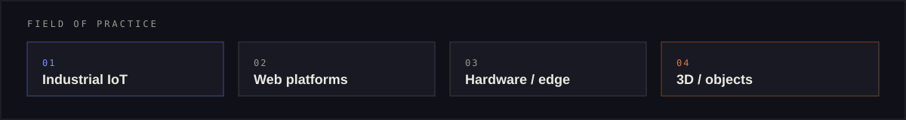

  

 

  
  
  
  

  
  
  
  

### Hi, I'm Nil Torres Parellada

**Lead Software Engineer · Industrial IoT @ [AEInnova](https://aeinnova.com/) · L'Hospitalet / Barcelona**

I design systems that reach production: platforms you ship, products you can open, and objects you can touch.

Most day-to-day code lives in **private repos** (product + company work). What you see here are live demos, theses, hardware write-ups and case pages. The full archive lives on **[nil.nailus.online](https://nil.nailus.online/)**.

## Now

- Leading AEInnova's software ecosystem: cloud IoT platforms, ops tools, edge over MQTT / LoRaWAN / NB-IoT
- Mentoring a team of five; architecture and standards with the CTO; product owner through customer deploy
- Shipping side products under Nailus (CareerOS, Nailus game, Cairn, Transmute…)
- Open to **selected commissions**: web platforms, custom software+hardware, 3D runs

## Featured products

<table>
  <tr>
    <td width="50%" valign="top">
      
        
      <b><a href="https://transmute-lemon.vercel.app/">Transmute</a></b> · product · 2025 
      Text, image and data converter with Monaco and a custom JS decoder. No ads, local history. 
      <code>Next.js</code> · <code>TypeScript</code> · <code>Monaco</code> 
      <a href="https://nil.nailus.online/en/build/transmute">Case</a> · <a href="https://transmute-lemon.vercel.app/">Live</a>
    </td>
    <td width="50%" valign="top">
      
        
      <b><a href="https://careeros.nailus.online/">CareerOS</a></b> · product · 2026 
      CRM for your career: companies, pipeline, network, map, Chrome clipper, Google sign-in. 
      <code>Next.js</code> · <code>Postgres</code> · <code>Prisma</code> · <code>MUI</code> 
      <a href="https://nil.nailus.online/en/build/careeros">Case</a> · <a href="https://careeros.nailus.online/">Live</a>
    </td>
  </tr>
  <tr>
    <td width="50%" valign="top">
      
        
      <b><a href="https://nailus.online/">Nailus</a></b> · product · 2026 
      Online trick-taking game: rooms, ranking, season, AI practice. Same match on web and mobile. 
      <code>Next.js</code> · <code>Socket.IO</code> · <code>Capacitor</code> 
      <a href="https://nil.nailus.online/en/build/nailus">Case</a> · <a href="https://nailus.online/">Live</a>
    </td>
    <td width="50%" valign="top">
      
        
      <b><a href="https://correctum.vercel.app/">Correctum</a></b> · product · 2023 
      Multilingual spelling and grammar checker with read-aloud. Installable as a PWA. 
      <code>Next.js</code> · <code>LanguageTool</code> 
      <a href="https://nil.nailus.online/en/build/correctum">Case</a> · <a href="https://correctum.vercel.app/">Live</a>
    </td>
  </tr>
</table>

## More products and experiments

<table>
  <tr>
    <td width="33%" valign="top">
      
        
      <b><a href="https://cryptotrackcat.vercel.app/">Crypto Tracker</a></b> · 2024 
      Market board, exchanges and 1inch swap. No custody. 
      <a href="https://nil.nailus.online/en/build/cryptotrack">Case</a>
    </td>
    <td width="33%" valign="top">
      
        
      <b><a href="https://ntpsecure.vercel.app/">NTPSecure</a></b> · 2023 
      Cybercrime guides, reports and follow-up. 
      <a href="https://nil.nailus.online/en/build/ntpsecure">Case</a>
    </td>
    <td width="33%" valign="top">
      
        
      <b><a href="https://descentralid.vercel.app/">Descentralid</a></b> · 2023 
      Wallet-gated vault for docs, passwords, licenses. 
      <a href="https://nil.nailus.online/en/build/descentralid">Case</a>
    </td>
  </tr>
</table>

| Project | Year | What it is | Open |
| --- | --- | --- | --- |
| **[Transmute](https://transmute-lemon.vercel.app/)** | 2025 | Converter for text, images and data + custom JS decoder | [case](https://nil.nailus.online/en/build/transmute) |
| **[CareerOS](https://careeros.nailus.online/)** | 2026 | Career CRM: pipeline, contacts, map, Chrome clipper | [case](https://nil.nailus.online/en/build/careeros) |
| **[Nailus](https://nailus.online/)** | 2026 | Online card game · web + Capacitor | [case](https://nil.nailus.online/en/build/nailus) |
| **[Correctum](https://correctum.vercel.app/)** | 2023 | Multilingual checker · PWA | [case](https://nil.nailus.online/en/build/correctum) |
| **[NTPSecure](https://ntpsecure.vercel.app/)** | 2023 | Learn, guide, report cybersecurity incidents | [case](https://nil.nailus.online/en/build/ntpsecure) |
| **[Crypto Tracker](https://cryptotrackcat.vercel.app/)** | 2024 | Market + exchanges + WalletConnect swap | [case](https://nil.nailus.online/en/build/cryptotrack) |
| **[Descentralid](https://descentralid.vercel.app/)** | 2023 | Encrypted vault with wallet identity | [case](https://nil.nailus.online/en/build/descentralid) |
| **[niltpH](https://tech-in-japan.github.io/articles/405437/index.html)** | 2014 | Proxy / launcher for iCloud-locked iPhones | [case](https://nil.nailus.online/en/build/niltph) |
| **NTP Metacenter** | 2023 | Unity metaverse prototype (PC, mobile, VR) | [case](https://nil.nailus.online/en/build/metacenter) |

## Hardware and embedded

<table>
  <tr>
    <td width="50%" valign="top">
      
        
      <b><a href="https://ddd.uab.cat/record/282963">ESP32CAM: IR + object detection</a></b> · dual BSc thesis · 2023 
      Object tracking with servo, IR temperature, MQTT, Node-RED, InfluxDB, Grafana. Grades: 9.1 (CS) / 9.0 (Telecom). 
      <a href="https://ddd.uab.cat/record/272818">CS thesis</a> · <a href="https://ddd.uab.cat/record/282963">Telecom thesis</a> · <a href="https://nil.nailus.online/en/build/esp32cam-tfg">Case</a>
    </td>
    <td width="50%" valign="top">
      
        
      <b><a href="https://github.com/ptorras/dodgemip">DodgeMiP</a></b> · 2021 
      Bare-metal game on FRDM-KL25Z: two buttons, 16×2 LCD, C / CodeWarrior. 
      <a href="https://github.com/ptorras/dodgemip">Source</a> · <a href="https://nil.nailus.online/en/build/dogemip">Case</a>
    </td>
  </tr>
  <tr>
    <td width="50%" valign="top">
      
        
      <b><a href="https://nil.nailus.online/en/build/nats">NATS: smart clothing</a></b> · 2017 
      LilyPad wearable + Android app over Bluetooth to an 8×8 LED matrix. Premi Argó honourable mention. 
      <a href="https://nil.nailus.online/en/build/nats">Case</a>
    </td>
    <td width="50%" valign="top">
      
        
      <b><a href="https://tech-in-japan.github.io/articles/405437/index.html">niltpH</a></b> · 2014 
      Public proxy so an iCloud-locked iPhone could still be used and browse. 
      <a href="https://nil.nailus.online/en/build/niltph">Case</a> · <a href="https://tech-in-japan.github.io/articles/405437/index.html">Write-up</a>
    </td>
  </tr>
</table>

## 3D and physical

<table>
  <tr>
    <td width="33%" valign="top">
      
        
      <b><a href="https://trophy.nailus.online/">Cairn</a></b> · 2026 
      3D trophies shaped like the ground walked. First: Pacific Crest Trail configurator (trophy, badge, terminus). 
      <code>Three.js</code> · <code>OpenSCAD</code> · <code>FDM</code> 
      <a href="https://nil.nailus.online/en/build/cairn">Case</a> · <a href="https://trophy.nailus.online/">Live</a>
    </td>
    <td width="33%" valign="top">
      
        
      <b><a href="https://nil.nailus.online/en/build/llaveros-amalvigia">Tribute keychains</a></b> · 2026 
      100 FDM pieces for IV Reconeixement Amalvígia (dones de l'Hospitalet), from a handwritten design. 
      <a href="https://nil.nailus.online/en/build/llaveros-amalvigia">Case</a>
    </td>
    <td width="33%" valign="top">
      
        
      <b><a href="https://nil.nailus.online/en/build/tarjeta-nil">NIL card</a></b> · 2026 
      85×55 mm 3D-printed contact card: brand on the front, QR on the back. 
      <code>OpenSCAD</code> · <code>FDM</code> 
      <a href="https://nil.nailus.online/en/build/tarjeta-nil">Case</a>
    </td>
  </tr>
</table>

## Path

| When | Where | Role |
| --- | --- | --- |
| **2023 → now** | [AEInnova](https://aeinnova.com/) · Terrassa | **Lead Software Engineer**: cloud IoT platforms, edge (MQTT / LoRaWAN / NB-IoT), mentoring ×5, product owner to customer deploy |
| **2022 → 2023** | NTT DATA · Barcelona | **Full-Stack Developer**: public-sector / healthcare microservices (Java, Spring Boot, React, Postgres) |
| **2017 → 2023** | [UAB](https://www.uab.cat/web/estudiar/listado-de-grados/informacion-general/ingenieria-informatica-ingenieria-electronica-de-telecomunicacion-1216708258897.html?param1=1345654053765) · Bellaterra | **Double degree (5y / 333 ECTS)**: Computer Engineering (Computer Engineering specialization) + Telecommunications Electronics Engineering; dual bachelor's theses on ESP32CAM; internship at NTT DATA (9.9) |

Also on the floor with AEInnova at Smart City Expo, MWC, IOTSWC, Advanced Factories, ISE (2023–2026), and EIC Summer School on Cybersecurity (Athens, 2025).

## Recognition

- **2017** · Honourable mention, [Premi Argó](https://www.uab.cat/) (Technology) for **NATS** smart clothing
- **2017** · 2nd prize, Baccalaureate Science and Technology Days (L'Hospitalet)
- **2017** · Accésit (runner-up), UPF Prize for Research Projects in Engineering and Applied Mathematics

## Stack I actually use

From the CV, day job, portfolio builds, early LAMP years, the [UAB double-degree plan](https://www.uab.cat/web/estudiar/listado-de-grados/plan-de-estudios/plan-de-estudios-y-horarios/ingenieria-informatica-ingenieria-electronica-de-telecomunicacion-1345467893054.html?param1=1345654053765) and the tools on this workstation. Grouped so the signal stays clear.

### Domain

`Industrial IoT` · `IoT` · `Software architecture` · `Cloud architecture` · `Platform engineering` · `Edge-to-cloud` · `Industrial protocols` · `Embedded systems` · `Microcontrollers` · `Computer architecture` · `Operating systems` · `Network engineering` · `TCP/IP` · `RF / microwaves` · `Signals & systems / DSP` · `Electromagnetics` · `Control systems` · `Instrumentation` · `Hardware architecture` · `Circuit design` · `Analog / power electronics` · `HDL / digital design` · `Information security` · `Privacy / anonymity tooling` · `Parallel computing` · `Big data apps` · `Computer vision` · `Blockchain` · `DApps` · `DevOps` · `Product ownership` · `Agile` · `AI tooling`

### Languages and runtimes

  
  
  
  
  
  
  
  
  
  
  
  
  
  

### Web and product

  
  
  
  
  
  
  
  
  
  
  

### Backend and data

  
  
  
  
  
  
  
  
  
  
  
  
  
  
  
  

### Cloud, containers and DevOps

  
  
  
  
  
  
  
  
  
  
  
  
  
  
  
  

### Hosting, DNS and PaaS

Shared hosting from early projects through modern app platforms.

  
  
  
  
  
  
  
  
  
  
  
  
  
  
  
  
  

### Industrial IoT and connectivity

  
  
  
  
  
  
  
  
  
  

### Embedded, mobile and hardware

  
  
  
  
  
  
  
  
  
  
  
  
  
  

### Editors and workstation

  
  
  
  
  
  
  
  
  
  

### Networks, remote and security

  
  
  
  
  
  
  
  
  
  
  
  
  
  
  
  
  
  
  
  
  

### Local AI

  
  
  

### Web3 and experiments

From Descentralid, Crypto Tracker, NailusDAO / Clarinet and bCAT DAO landing.

  
  
  
  
  
  
  
  
  
  
  
  
  
  
  
  
  
  
  
  
  
  
  
  

### 3D, CAD, print and XR

  
  
  
  
  
  
  
  
  
  
  
  
  

### Media and capture

  
  
  
  

### Early years: scripts, desktop and LAMP

Started young with `.bat` scripts and similar Windows automation, desktop apps in Visual Studio, then the classic LAMP stack: local servers, PHP pages and databases in the browser. Same era as [niltpH](https://nil.nailus.online/en/build/niltph).

  
  
  
  
  
  
  
  
  
  
  
  

### UAB double degree foundations

[UAB School of Engineering](https://www.uab.cat/web/estudiar/listado-de-grados/informacion-general/ingenieria-informatica-ingenieria-electronica-de-telecomunicacion-1216708258897.html?param1=1345654053765) · Bellaterra · **5 years / 333 ECTS** · two official degrees:

1. **Computer Engineering**, specialization **Computer Engineering** (Ingeniería de Computadores)
2. **Telecommunications Electronics Engineering**

[Curriculum](https://www.uab.cat/web/estudiar/listado-de-grados/plan-de-estudios/plan-de-estudios-y-horarios/ingenieria-informatica-ingenieria-electronica-de-telecomunicacion-1345467893054.html?param1=1345654053765) · internship at NTT DATA **9.9/10** · dual bachelor's theses / TFG (ESP32CAM): CS **9.1** / Telecom **9.0**

**By year (core path)**

| Year | Focus |
| --- | --- |
| **1** | Algebra, Calculus, Discrete mathematics · Programming 1–2 · Circuit theory and electronics · Systems software · Signals and systems · Theory of computation · Business organization |
| **2** | Digital systems and HDL (year-long) · Electromagnetic fields and waves (year-long) · Computer organization · Operating systems · Programming 3 · Databases · Probability and stochastic processes · Information and security · Networks I / II · Software engineering |
| **3** | Radiation and guided waves (year-long) · Electronic components and circuits · Analog electronics · Discrete-time signals and systems · Cloud computing · Web / Internet technologies · Computer architecture · AI · Communication signals and systems · Ethics, project management and legislation |
| **4** | Control systems · Transmitter / receiver electronics · Big-data applications · Electronic systems design I–II · Electronic circuits and technologies · Microelectronics I · Parallel programming · Embedded systems · RF and microwaves · Network management and administration |
| **5** | Instrumentation I–II · Power electronics · Microelectronics II · **2× bachelor's theses (TFG)** · electives (12–18 ECTS) |

**Computer Engineering specialization** (courses marked in the official plan): big-data applications, electronic systems design, microelectronics, parallel programming, embedded systems, network administration, plus one of IoT / smart devices / server and cloud security.

**Labs and tooling from the degree**

`VHDL` · `Verilog` · `FPGA` (Intel/Altera Quartus) · `ModelSim` · `RISC-V` (lab processor) · `RTOS` · `PSoC / SoC` · `MATLAB / Simulink` · networking labs · instrumentation and control · RF / microwave circuits

**Knowledge areas**

`Computer architecture` · `Operating systems` · `Databases` · `Software engineering` · `Computer networks` · `InfoSec` · `Cloud and web` · `AI / ML` · `Parallel computing` · `Embedded systems` · `Digital / analog electronics` · `Microelectronics` · `DSP / signals` · `Electromagnetics` · `RF and microwaves` · `Transmitters / receivers` · `Control systems` · `Instrumentation` · `Power electronics` · `Project management and legislation`

  
  
  
  
  
  
  
  
  
  
  
  
  
  
  
  
  
  
  
  
  
  
  
  
  
  
  

### Business systems, IT and security platforms

  
  
  
  
  
  
  
  
  

### Collaboration

  
  
  

### How I work

`Technical leadership` · `Mentoring` · `Small teams` · `Product owner` · `Requirements analysis` · `Architecture standards` · `Code review` · `Customer deployments` · `Cross-functional R&D` · `Spanish / Catalan native` · `English C1`

## Work with me

Commissions under **Nailus**: web platforms / MVPs, 3D design and short print runs, or custom software + hardware when the job does not fit a template.

  
  

## Elsewhere

- Portfolio: [nil.nailus.online](https://nil.nailus.online/)
- Build archive: [nil.nailus.online/en/build](https://nil.nailus.online/en/build)
- About / path: [nil.nailus.online/en/about](https://nil.nailus.online/en/about)
- LinkedIn: [linkedin.com/in/niltopa](https://www.linkedin.com/in/niltopa/)
- Email: [niltopa@protonmail.com](mailto:niltopa@protonmail.com)

    
  <i>Private by default. Public where it helps.</i> 
  <a href="https://nil.nailus.online/">Browse the full build archive →</a>

